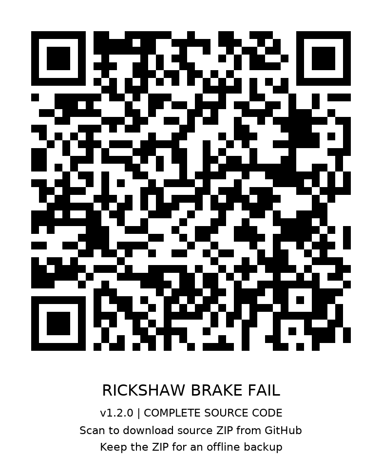

# Complete source-code QR — Rickshaw Brake Fail v1.2.0

**Direct source ZIP:** https://github.com/Ishtiakru/RickshawGame/archive/6e51eecb428aec99093c442e29829decfa90defc.zip

This QR contains the public ZIP download URL, not the source code bytes. Internet is needed to download it. Keep the ZIP as an offline backup. Anyone with the QR can access this public source snapshot. Availability depends on the GitHub repository remaining public and available. The QR is fixed to the v1.2.0 code snapshot and does not update automatically.

# Rickshaw Brake Fail — complete source handoff

Version: 1.2.0
Source commit: 6e51eecb428aec99093c442e29829decfa90defc
Repository: https://github.com/Ishtiakru/RickshawGame
Exact source snapshot: https://github.com/Ishtiakru/RickshawGame/tree/6e51eecb428aec99093c442e29829decfa90defc
Development PR: https://github.com/Ishtiakru/RickshawGame/pull/2
Download this bundle: https://github.com/Ishtiakru/RickshawGame/archive/6e51eecb428aec99093c442e29829decfa90defc.zip

## Bangla / Banglish instructions
Ei ZIP-er moddhe ei version-er puro source code ache, shudhu APK na.
Extract kore puro folder-ta developer-ke dao. QR chobita code nijey dhore na;
QR scan korle GitHub theke ei ZIP download hoy. Download-er jonno Internet lagbe.
Offline backup-er jonno ZIP-ta nijer phone/Drive-e save kore rakho.
Link kaj korar jonno repository/release public ar available thakte hobe.
QR ekta fixed v1.2.0 snapshot; future changes ete automatic ashbe na.

## Start here
- `README.md`: run/build/install details and sound troubleshooting.
- `index.html`: standalone browser game, UI, controls, collisions, scoring and sound routing.
- `audio/*.wav`: original sound clips (not copyrighted third-party recordings).
- `scripts/generate-sounds.py`: regenerate PCM clips (Python 3).
- `scripts/sync-audio.mjs`: embed WAVs in HTML and copy Android raw resources.
- `scripts/sync-android.mjs`: synchronize canonical game into APK assets.
- `android/app/src/main/java/com/sojib/rickshaw/MainActivity.java`: Android WebView shell/lifecycle.
- `android/app/src/main/java/com/sojib/rickshaw/GameAudio.java`: native MediaPlayer/SoundPool, focus and sound status bridge.
- `android/app/src/main/res/raw/`: generated native audio copies.
- `android/app/build.gradle`: Android version, SDK and dependency settings.
- `.github/workflows/android-apk.yml`: browser tests, native build/lint/emulator smoke test, signature verification and prerelease APK upload.
- `tests/`: Playwright browser/game/media tests.
- `android/app/src/androidTest/`: native audio/JS bridge/lifecycle emulator test.

## How to change or add a feature
1. Extract this ZIP and edit the root `index.html` for gameplay/UI changes.
2. Change native audio/lifecycle in Java only if required. The JS bridge must remain
   local-content-only; do not load untrusted pages into this bridged WebView.
3. If changing clips, regenerate using `python3 scripts/generate-sounds.py`.
4. Run `npm ci`, `npm run sync:android` and `npm run dev` (Node.js 22 + Python 3).
5. Tests: `npx playwright install --with-deps chromium`, then `npm test`.
6. Native build: install JDK 17 + Android SDK 35, then `cd android` and
   `./gradlew assembleDebug lintDebug`. `connectedDebugAndroidTest` needs a device/emulator.
7. Bump `versionCode`/`versionName` in app/build.gradle and matching workflow/visible
   UI versions for a new release. Sync HTML/assets before committing.
8. Test on the actual phone: speaker output cannot be proven by software playback
   assertions. Use SOUND HELP > TEST SOUND and inspect media volume/focus/errors.

## What is included / not included
- Every Git-tracked source/config/test file at the commit above (37 files).
- The developer guide and SHA-256 source manifest are separately available beside the QR in the repository handoff/ folder; they are not inside this earlier source snapshot.
- Build dependencies, node_modules, Android SDK/JDK, generated build directories,
  local credentials and APKs are intentionally not bundled. Tools download their
  own dependencies. No Firebase account or secret keys are needed.
- This is the complete final source snapshot, NOT every intermediate historical
  version. Git commit history remains in the repository; a developer can clone it.
- The QR points to GitHub's fixed-commit source ZIP, not an APK. APK: https://github.com/Ishtiakru/RickshawGame/releases/tag/android-v1.2.0-4
- The APK is debug-signed for testing, not a production Play Store signing setup.
  The owner's release signing key is not part of this bundle. Cached debug keys
  can change; uninstalling an old test APK may be necessary and erases local scores.
- The GitHub Pages site uses main; PR #2 must be merged/deployed for browser updates.

Git history (optional): `git clone https://github.com/Ishtiakru/RickshawGame.git`
A downloaded ZIP has no Git history or GitHub push permissions; the developer should
work in a separate checkout/fork and obtain the owner's permission to publish updates.
